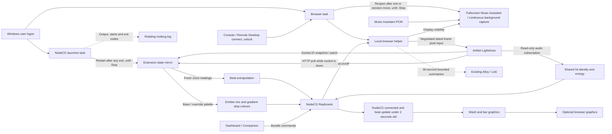

# party-visuals

Local party display controls and browser graphics that keep time with the lightshow
([artnet-lightshow](https://github.com/tyclab/artnet-lightshow)). A
[NodeCG](https://www.nodecg.dev) 2 bundle that runs in the same NodeCG as
[EclipseGraphics](https://github.com/LightD31/EclipseGraphics): EclipseGraphics draws the
cards, lower thirds and tickers, this bundle draws what moves with the music behind and
around them.

The show PC displays Music Assistant's native MilkDrop visualizer in fullscreen
Chrome. The browser launcher opens it in a dedicated persistent profile on
whichever screen it was last left and follows the existing Companion visual on/off controls. OBS is not
part of this workflow. The wash and bar below remain available as optional local
graphics.

- **Colour wash** (`graphics/wash.html`): the whole frame in the lightshow's palette, to
  sit under EclipseGraphics' cards. The colours turn and flow with the beat; each beat
  lifts the wash a little and swells a glow in the middle.
- **Beat bar** (`graphics/bar.html`): a band of the palette's colours across the bottom of
  the frame (`?position=top` for the top), scrolling half a block a beat and swelling on
  each beat.

Both are 1920 × 1080 with a transparent background, take the lightshow's palette (its
palette override when it has one, else the look's colours), and:

- **never pulse faster than 5 Hz**, the photosensitivity limit the lightshow holds its own
  strobe to: up to 300 bpm a pulse a beat,
  above that every second or fourth beat, and at
  least 200 ms between two pulses whatever the beat position does;
- **draw at most `graphics.maxFps` frames a second** (30 by default);
- **go calm when the lightshow or NodeCG link is gone**: no new pulse, the glow fades
  within a second, the motion stops where it was and the last colours stay. Graphics
  require a connected NodeCG socket, a connected lightshow and a beat update less than
  two seconds old. A lost NodeCG socket stops new pulses immediately; missing beat
  updates stop them after two seconds. Reconnecting waits for a fresh beat update and
  eases the beat back in.

The beat comes from the lightshow, not from a tap here. In Reactive mode,
the graphics can also follow its shared audio hits and energy.
The wash brightens and expands with the music, and the bar grows with its energy.
Audio and tempo pulses share one five-pulse-per-second cap. The dashboard reports
whether shared audio is available; a lost audio feed returns to tempo and colour
animation without replaying old hits. Screen and lamp effects share musical input,
but this does not mirror individual lamp pixels or certify optical latency.

Between clock readings, the extension and every graphic extrapolate the beat at
the last tempo, so the pictures move smoothly at the graphics' own frame rate.

## Install beside EclipseGraphics

NodeCG 2 (tested with 2.8.0) and Node 22 or later, as for EclipseGraphics. The bundle
has one dependency of its own, `socket.io-client`.

**With EclipseGraphics' own `npm start`** (NodeCG installed as EclipseGraphics'
dependency, which loads the bundles in its `bundles/` folder too):

```
cd EclipseGraphics
git clone https://github.com/tyclab/party-visuals bundles/party-visuals
cd bundles/party-visuals && npm install --omit=dev && cd ../..
echo bundles/ >> .git/info/exclude
```

Then write the configuration below into EclipseGraphics' `cfg/` folder and `npm start` as
before.

**In a NodeCG installation with a `bundles/` folder**: clone into
`bundles/party-visuals`, run `npm install --omit=dev` there, and put the configuration
in that installation's `cfg/` folder.

The dashboard (<http://127.0.0.1:9090/>) gets a **Party visuals** panel next to
EclipseGraphics' panels.

## Install on the show PC

[`install/`](install) provides the Windows browser, NodeCG and Companion setup:

| File | |
|---|---|
| [`Install-PartyVisuals.ps1`](install/Install-PartyVisuals.ps1) | Installs EclipseGraphics and this bundle at pinned commits, keeps NodeCG to this machine, stores the lightshow token and, with `-Autostart`, keeps NodeCG running from logon. Windows PowerShell 5.1 or PowerShell 7. |
| [`Start-PartyVisualsNodecg.ps1`](install/Start-PartyVisualsNodecg.ps1) | Runs NodeCG without a window, starts it again after any exit, and logs its output and exit codes. `-Register`, `-Stop` and `-Resume` manage its task. |
| [`Start-PartyVisualsBrowser.ps1`](install/Start-PartyVisualsBrowser.ps1) | Opens the visualizer fullscreen in a dedicated Chrome profile, reopens it after it closes or the session moves, and supervises the local browser helper. `-Register`, `-Stop` and `-Resume` manage its task. |
| [`companion-page.md`](install/companion-page.md) | A Companion page with the lightshow's buttons and the visuals' side by side. |

From a normal (not elevated) PowerShell window, as the Windows user who runs the show:

```
git clone https://github.com/tyclab/party-visuals
cd party-visuals\install
powershell -ExecutionPolicy Bypass -File .\Install-PartyVisuals.ps1 -LightshowUrl http://<lightshow host>:3000 -Autostart -WhatIf
powershell -ExecutionPolicy Bypass -File .\Install-PartyVisuals.ps1 -LightshowUrl http://<lightshow host>:3000 -Autostart
Start-ScheduledTask -TaskName 'PartyVisuals NodeCG'
```

The run with `-WhatIf` lists what would change and changes nothing. The run without it
asks for the lightshow's token (its **Settings → Server & access**; the input is
hidden). Then the dashboard, <http://127.0.0.1:9090/>, shows the **Party visuals**
panel and its link to the lightshow.

What the script does:

1. Checks for Node.js 22 or later and git. Without them it prints the command that
   installs them (`winget install --id OpenJS.NodeJS.LTS --exact`,
   `winget install --id Git.Git --exact`) and stops.
2. Clones EclipseGraphics into `%LOCALAPPDATA%\PartyVisuals\EclipseGraphics` (`-Root`
   for another folder) and runs `npm ci` with install scripts off. Only better-sqlite3,
   NodeCG's database driver, then runs its own: it fetches or builds the native module
   NodeCG cannot start without. With npm 11.16 or later that one allowance is a line in
   the checkout's `.npmrc`.
3. Clones this bundle into its `bundles\party-visuals` and runs `npm ci --omit=dev`.
4. Writes `cfg\nodecg.json` (NodeCG on 127.0.0.1:9090) and `cfg\party-visuals.json`
   (the lightshow's address and the token file; a new one also gets `graphics.offsetMs`
   at 0 for the beamer), keeping any other setting already in them, a tuned `offsetMs`
   included.
5. Writes the token to `cfg\party-visuals.token`, readable by this Windows user only
   (inheritance off, one rule). It is not shown, logged or put on a command line.
6. With `-Autostart`, copies `Start-PartyVisualsNodecg.ps1` to
   `%LOCALAPPDATA%\PartyVisuals\startup` and registers its scheduled task
   **PartyVisuals NodeCG** ([Keeping NodeCG running](#keeping-nodecg-running)).

It can be run again: what is in place is kept, and the packages are installed again
only when a lockfile or the Node.js major version changed. `-NewToken` asks for the token again,
`-LightshowUrl` changes the address, `-EclipseGraphicsCommit` and `-BundleRef` (a commit,
or a `vX.Y.Z` tag) move the pins, and `-Uninstall` removes the task and the folder, only
a folder the script set up (its marker file in it) and not one reached through a link.
NodeCG reads its configuration and the token when it starts, so restart it after a
change (`Stop-ScheduledTask`, then `Start-ScheduledTask`). The rest is in the script's
help, read with the execution policy bypassed as for the run (a plain `Get-Help` finds
nothing while the policy blocks scripts):

```
powershell -ExecutionPolicy Bypass -Command "Get-Help .\Install-PartyVisuals.ps1 -Detailed"
```

For the native Music Assistant visualizer, install Chrome and copy
[`tools/browser-visuals`](https://github.com/tyclab/artnet-lightshow/tree/main/tools/browser-visuals)
from the matching ArtNet Lightshow release to
`%LOCALAPPDATA%\PartyVisuals\browser-visuals`, then run `npm.cmd ci --omit=dev`
in that folder. Copy `Start-PartyVisualsBrowser.ps1` into the local startup folder.
The default player URL selects SHD; configure `-VisualizerUrl` for another player.
Sign in to Music Assistant once in the dedicated browser profile.

As the user who runs the show, register the **PartyVisuals Browser** task from the
copied launcher, with the output switches the task should use, and start it:

```
$launcher = "$env:LOCALAPPDATA\PartyVisuals\startup\Start-PartyVisualsBrowser.ps1"
powershell -NoProfile -ExecutionPolicy Bypass -File $launcher -Register -Room -Curtain
Start-ScheduledTask -TaskName 'PartyVisuals Browser'
```

`-Register` replaces a task of that name. The task runs Windows PowerShell hidden
with this launcher and the other arguments given to `-Register`, with limited
privileges, normal priority (Task Scheduler's default starts it below normal) and
no time limit, at this user's logon and whenever the session
connects at the console or over Remote Desktop or is unlocked. It ignores
duplicate starts, starts when available and retries failures every minute. After
replacing the launcher file, stop and start the task once (`Stop-ScheduledTask`,
`Start-ScheduledTask`); the open window is adopted, not reopened.

The launcher keeps the visuals open. When the window closes, whether by a crash,
the session or a click, it reopens it after 5 seconds; while it keeps closing
within a minute of opening, the pause doubles up to 5 minutes. The local helper
keeps running meanwhile. When the session moves between the console and Remote
Desktop, the launcher closes the window once the new connection has settled for
10 seconds and opens a fresh one: a Chrome started for the previous display keeps
rendering at a fraction of the screen's refresh. Locking, unlocking and
disconnecting leave the window as it is. It closes the window, not the process,
so Chrome remembers where it was.

To close the visuals on purpose, and to bring them back:

```
powershell -NoProfile -ExecutionPolicy Bypass -File "$env:LOCALAPPDATA\PartyVisuals\startup\Start-PartyVisualsBrowser.ps1" -Stop
powershell -NoProfile -ExecutionPolicy Bypass -File "$env:LOCALAPPDATA\PartyVisuals\startup\Start-PartyVisualsBrowser.ps1" -Resume
```

After `-Stop` they stay closed, across session moves and task restarts, until
`-Resume` (which starts the task) or the next sign-in. The stop is the file
`%LOCALAPPDATA%\PartyVisuals\browser-visuals.stop`. `Stop-ScheduledTask` alone
leaves the window open, and the next session connect or unlock starts the task again.

The launcher sets no screen or window size. Chrome reopens the app window on the
screen where it was last closed, so put it where it belongs once: leave fullscreen
with F11, drag it to that screen and press F11 again, or move it fullscreen with
Win+Shift+Left/Right. Chrome uses a dedicated persistent profile and an ephemeral
loopback debugging port; the helper accesses only the configured Music Assistant
player page.

The helper hides the album artwork, timeline and tint while retaining Music
Assistant's native visualizer. Existing Companion **VISUALS OFF/ON** buttons use
NodeCG's `wash.on` switch to cover or reveal it; `all/air.off` and `all/air.on`
already control that switch. Wash/bar intensity remains specific to those optional graphics.

The browser workflow runs without a lightshow output connection by default.
Optional `-Curtain` uses the separately deployed guarded pixel-input feature;
it never arms the rig. Follow the ArtNet helper documentation before enabling it.
Optional `-Room` streams the same picture as one colour per lamp cell, read at
each cell's place on the lightshow's plan, for the lightshow's **Picture:
Visualizer** selector (Perform or Settings → Show); with **Effects** selected the
show ignores it, so the switch is instant. Both switches can be combined and
are given to `-Register` for the "PartyVisuals Browser" task.
The launcher lets the helper negotiate its default capture rate with the lightshow
(`-Fps 0`, the default).
The dedicated profile disables Chrome's occlusion backgrounding, renderer priority
reduction and background timer throttling so a visible visualizer continues
capturing when another window takes focus. This applies only to the dedicated
profile. After updating these launch flags, close that browser window once before
restarting the task; the launcher refuses to adopt a window with the old flags.
The profile, login and saved window placement stay in place.

With the matching Tyclab Lightshow helper this targets 44 fps.
Optional `-Fps 60` requests up to 60 captures per second from a
matching helper/server release. Actual refresh depends on capture and delivery
time, and lighting output currently runs at 44 Hz. Frames stay current instead
of accumulating in a delivery queue; flash limits remain separate from refresh.

Output mode requires the matching helper with `--telemetry-file` support. It writes
one summary per output every 30 seconds to
`%LOCALAPPDATA%\PartyVisuals\logs\browser-visuals.ndjson`, retaining at most two
1 MiB files. Summaries report acknowledged input rate, capture/ACK latency and
failure counts; they contain no credentials, player URLs or fixture identities.
The fleet's Windows Alloy installer collects the active file. Display-only mode
does not collect pixel telemetry, and log failures never stop capture.

The browser's own Music Assistant audio path determines visualizer timing;
`graphics.offsetMs` applies only to this bundle's wash/bar graphics.

NodeCG listens on 127.0.0.1 only, so the browser helper and Companion run on the show PC too. The show
PC reaches the lightshow at its port 3000, which the lightshow's host has to admit from
the show PC's address; that is set up on the lightshow's host, not by this script. The
address's host name has to be one the lightshow answers to (its machine name, an IP
address, or its **Public URL**), or the lightshow answers 403 and the panel says so
([The network](#the-network)).

### Keeping NodeCG running

The **PartyVisuals NodeCG** task runs the launcher at this user's logon with limited
privileges, normal priority (Task Scheduler's default starts it below normal) and no
time limit. It ignores duplicate starts, starts when available and retries a failed
start every minute. It runs Windows PowerShell inside a headless console host, so
neither the launcher nor NodeCG has a window. A console of NodeCG's own would be a
terminal window under Windows Terminal, where Ctrl+C ends NodeCG with exit code 0 and
the terminal then closes the window.

The launcher starts EclipseGraphics' `start.js` and starts it again whenever it exits,
with any exit code, after 5 seconds; while it keeps exiting within ten minutes of
starting (NodeCG itself takes about a minute to start), the pause doubles up to 5
minutes. Task Scheduler's restart-on-failure does not restart NodeCG when it exits,
whether with code 0 or 1.

NodeCG's output, and each start and exit with its time and exit code, go to
`%LOCALAPPDATA%\PartyVisuals\logs\nodecg.log`, at most two 1 MiB files
(`nodecg.log.1` is the older). Each line starts with the UTC time and `launcher`,
`stdout` or `stderr`. Exit code 0 is a clean shutdown, the one Ctrl+C or a stop gives;
1 is NodeCG giving up on an error, which it logs just before. NodeCG's own
`logs\nodecg.log` in the EclipseGraphics folder stays empty: NodeCG's file logging is
off by default.

When NodeCG cannot listen on its port, a launcher line says so before the exit, with
the port and the error: `EACCES` when Windows reserves or blocks the port, `EADDRINUSE`
when a program holds it. Windows reserves port blocks inside its dynamic port range
(`netsh int ipv4 show dynamicport tcp`), and
`netsh int ipv4 show excludedportrange protocol=tcp` lists them; a range that reaches
9090 blocks NodeCG. The launcher keeps retrying with the same pauses.

To stop NodeCG on purpose, and to bring it back:

```
powershell -NoProfile -ExecutionPolicy Bypass -File "$env:LOCALAPPDATA\PartyVisuals\startup\Start-PartyVisualsNodecg.ps1" -Stop
powershell -NoProfile -ExecutionPolicy Bypass -File "$env:LOCALAPPDATA\PartyVisuals\startup\Start-PartyVisualsNodecg.ps1" -Resume
```

`-Stop` closes NodeCG's standard input, which shuts it down as Ctrl+C does (it saves
its state first), and waits for the launcher to end. NodeCG stays stopped across task
restarts until `-Resume` (which starts the task) or the next sign-in. The stop is the
file `%LOCALAPPDATA%\PartyVisuals\nodecg.stop`. `Stop-ScheduledTask` stops NodeCG
until the next logon. For an install with another `-Root`, give `-Stop` and `-Resume`
the task's `-NodecgRoot` and `-StopFile`.

To register the task without the installer, from the copied launcher:

```
$launcher = "$env:LOCALAPPDATA\PartyVisuals\startup\Start-PartyVisualsNodecg.ps1"
powershell -NoProfile -ExecutionPolicy Bypass -File $launcher -Register
```

`-Register` replaces a task of that name and forwards `-NodeExe`, `-NodecgRoot`,
`-LogFile` and `-StopFile` when they are given. After replacing the task or the
launcher file, stop and start the task once.

## Configuration

`cfg/party-visuals.json` (all optional; [`configschema.json`](configschema.json)
describes it):

```json
{
  "lightshow": {
    "url": "http://tychome:3000",
    "tokenFile": "cfg/party-visuals.token"
  }
}
```

and `cfg/party-visuals.token` holding the lightshow's access token (its
**Settings → Server & access**) and nothing else.

**The token goes in a file, never in `cfg/party-visuals.json`**: NodeCG hands the bundle's
configuration to every page of the bundle, the OBS sources included, so anything in it can
be read by whatever can open a graphic. Only the extension reads the token file. A
`token` key in the configuration stops NodeCG at startup with a schema error; an address
with a token or a password in it is refused too (the connection shows the error and
nothing is sent).

| Option | |
|---|---|
| `lightshow.url` | The lightshow server, `http(s)://host:port` (default `http://127.0.0.1:3000`). |
| `lightshow.tokenFile` | The token file; a relative path starts at the folder NodeCG runs from. Empty: a lightshow with no token (bound to loopback). |
| `lightshow.pollMs` | How often `GET /api/state` is polled while the socket is down (default 1000). |
| `lightshow.reconnect.minMs` · `maxMs` | The wait before reconnecting: doubling from 500 ms up to 15 s, a little shorter at random. |
| `graphics.maxFps` | The most frames a second a graphic draws (default 30). |
| `graphics.offsetMs` | Shift the graphics' beat, −1000 to 1000 ms: positive draws it earlier, to make up for a projector's or OBS's delay. Judge it on the real screen. |
| `allowHosts` | Host names the `api/` addresses answer to besides IP addresses, `localhost` and `*.local` (Companion calling this machine by name). |

### The network

On the show PC, NodeCG reaches the lightshow over the network (`tychome:3000` in the
example above). The lightshow host keeps port 3000 to loopback and its single-sign-on
front door, so this connection needs a route: either the port opened to the show PC's
address, or a path through the front door that accepts the lightshow token on its own
(an extension cannot answer a browser login). Which one is a deployment decision, made and
recorded with the deployment, not in this repository. The lightshow also refuses host
names it does not know: reaching it by a name other than its machine name needs that name
as its **Public URL** (Settings → Server & access).

## Optional local graphics

Each graphic can be opened directly in a browser at 1920 × 1080:

| Source | URL |
|---|---|
| Colour wash, under EclipseGraphics' overlay | `http://127.0.0.1:9090/bundles/party-visuals/graphics/wash.html` |
| Beat bar, over it | `http://127.0.0.1:9090/bundles/party-visuals/graphics/bar.html` (`?position=top` for the top) |

The state lives in the extension, so a source refreshed or opened mid-show comes back as
it was. With NodeCG's login on, add the user's `?key=…` (NodeCG's Graphics tab gives the
address with it).

## Companion

Bitfocus Companion's **Generic HTTP** module, a GET request, as for EclipseGraphics:
`http://127.0.0.1:9090/bundles/party-visuals/api/cmd/<target>/<command>`.

| Target | Command | |
|---|---|---|
| `wash` · `bar` · `all` | `air.on` · `air.off` · `air.toggle` | On, off (both fade over 0.4 s). `all/air.off` takes both off. |
| | `intensity.<0-100>` · `intensity.+<n>` · `intensity.-<n>` | Brightness in percent, or a nudge. |

For example `…/api/cmd/wash/air.toggle`, `…/api/cmd/bar/intensity.60`,
`…/api/cmd/all/air.off`. A command answers `{"ok": true, "controls": …}`, or HTTP 400 with
`{"ok": false, "error": …}`. Also:

- `POST …/api/cmd` with `{"target": "…", "cmd": "…"}`;
- `GET …/api/state`: the switches, the connection, the tempo and the palette;
- from another bundle: `nodecg.sendMessageToBundle('cmd', 'party-visuals', {target, cmd})`,
  or from an extension `nodecg.extensions['party-visuals'].command(target, cmd)`.

Commands are refused (HTTP 403) when a browser says they come from another site, and
`api/` answers only to IP addresses, `localhost`, `*.local` and the `allowHosts` names.
With NodeCG's login on, add the user's `?key=…`.

## Replicants

Written by the extension; graphics and panels read them.

| Replicant | |
|---|---|
| `bpm` | The lightshow's tempo (its clock's, else the typed one); null before it has sent one. |
| `beatPos` | `{beat, bpm, at, epoch, locked}`: the beat position at time `at` (ms since 1970), re-published twice a second while connected; graphics extrapolate from it. `locked` says whether the phase came from the lightshow or is the extension's own. |
| `clockSource` | What the lightshow's clock follows: `auto`, `cdj`, `track`, `live` or `tap`. |
| `palette` | The base look's screen colours as `#RRGGBB`, white, amber and UV mixed in as the lightshow's own swatches show them; selected gradients use the stop-colour approximation below. Kept across restarts. |
| `paletteOverride` | The lightshow's palette override as `#RRGGBB`, or null (also when the lightshow does not send one). |
| `audioMode` | `off`, `tempo`, `reactive`, or null for older servers. |
| `audio` | Latest bounded shared audio frame with local receive timestamp, event identity, energy and bands; null while disconnected. Graphics discard it after 600 ms. |
| `connection` | `{status, via, since, lastUpdate, error, retryInMs, target}`; `status` is `connecting`, `connected`, `reconnecting`, `error` or `stopped` (NodeCG shutting down), `via` is `socket` or `http`. Never the token. |
| `controls` | `{wash: {on, intensity}, bar: {on, intensity}}`. Kept across restarts. |

Each has its JSON schema in `schemas/`.

## How it follows the lightshow



The extension is a read-only client of the lightshow server. It connects over Socket.IO
asking for protocol 2 (`auth: {token, protocol: 2}`), takes the snapshot, then applies
the patches, each domain's version in order; a missed patch makes it ask for the whole
state again (`sync`). It reads `bpm`, `clock` (`source`, `bpm`, and `beatPos` and `epoch`
when the lightshow sends them), `basePalette` and `overridePalette`. Older servers use
the four colour slots through the colour-preset catalogue and `paletteOverride`.
The three palette fields belong to the `look` domain; catalogue/library changes alone
do not refresh the beat. Palette-only and typed-bpm-only patches never reuse an old
`clock.beatPos` as a new clock reading. The extension sends `sync` and a read-only
`subscribe: ['audio']` request on each connection; it sends no lighting commands.
Audio packets never reset the musical clock. HTTP fallback retains tempo and
colour support but cannot supply the high-rate audio feed. Older audio producers
without event IDs supply energy only, so held classifications cannot retrigger.
The existing `graphics.offsetMs` compensates predictable beat phase; shared audio
hits arrive live and cannot be advanced before they are observed. Judge actual
screen/lamp alignment on the target display during commissioning.

Palette compatibility is checked against ArtNet Lightshow
[`2b539dc`](https://github.com/tyclab/artnet-lightshow/commit/2b539dc546757cb7f740817321eb7a56e0e88f44).
Hex colours accept `#RGB`, `#RRGGBB`, `#RRGGBBWW`, `#RRGGBBWWAA` and
`#RRGGBBWWAAUU`; the trailing bytes are emitters, never transparency. White adds to
all three screen channels, amber adds red and half as much green, and UV appears as
visible violet (20% red, 90% blue). Overflow is scaled proportionally, matching the
engine's swatches; a screen does not emit UV. New palette bodies take precedence;
clearing `overridePalette` restores the base colours. Stage random slots are resolved
by the engine before publication. An unresolved random marker uses its corresponding
legacy slot when available and is otherwise omitted; graphics never roll their own
random colours on refresh or reconnect.

**Gradient approximation:** the selected named gradient, or the selected gradient-set
role, supplies its stop colours in authored order (slot references and literal colours
both work). As in the engine, selection defaults to the first gradient. At most eight
distinct colours are retained in first-appearance order. The wash uses its existing
moving RGB blend and the bar uses its existing scrolling colour blocks. Stop positions,
RGB/OKLCH/step interpolation, wrap settings and repeated-stop spacing are not reproduced;
this follows the selected gradient's colours, not its authored spatial appearance.
Without a usable gradient, the palette's colours are used directly.

While the socket is down it polls `GET /api/state` (the token in the `X-Lightshow-Token`
header), so the tempo and colours get through a proxy that will not carry the socket.
Reconnecting is its own, with the backoff above, and goes on after a refused token, so a
token fixed on the lightshow's side is picked up without restarting NodeCG. A refused
poll (401: the token; 403: a host name the lightshow does not answer to) is not repeated
every second: the next socket attempt polls once more if it fails.

A lightshow that sends no beat position (the clock's `{source, bpm}` alone) still drives
the graphics at its tempo; the phase is then the extension's own, shared by every graphic.

## Development

Repository contribution rules and comment-limit approvals live in [AGENTS.md](AGENTS.md).

```
npm install
npm test
```

The tests run against a local mock of the lightshow's Socket.IO server; nothing leaves the
machine. `shared/` is loaded both by the extension and, as plain scripts, by the graphics.

On Windows, `powershell -NoProfile -ExecutionPolicy Bypass -File test\install.test.ps1`
checks the install script in a folder under `%TEMP%`: the token file, the configuration
merges and the install folder checks. It installs nothing and registers no task.
`test\browser-start.test.ps1` checks display identity, process ownership, browser/helper recovery,
the reopen pauses, `-Stop`/`-Resume` and the task definition with mocked Windows calls. It has
Task Scheduler validate the definition without registering it and leaves a running visuals task alone.
`test\nodecg-start.test.ps1` runs the NodeCG launcher against a stand-in NodeCG under `%TEMP%`
(Node.js required): the output and exit log and its rotation, the clean stop, restarts and their
pauses, `-Stop`/`-Resume`, the end of the task and the task definition, validated by Task Scheduler
and not registered. It leaves a running NodeCG task alone.

## Licence

MIT, see [LICENSE](LICENSE). NodeCG and Socket.IO are MIT-licensed.
